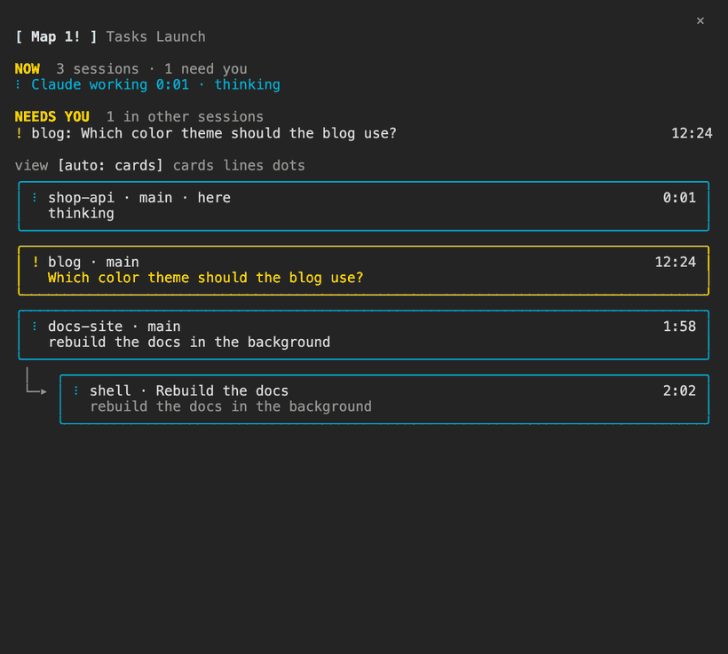
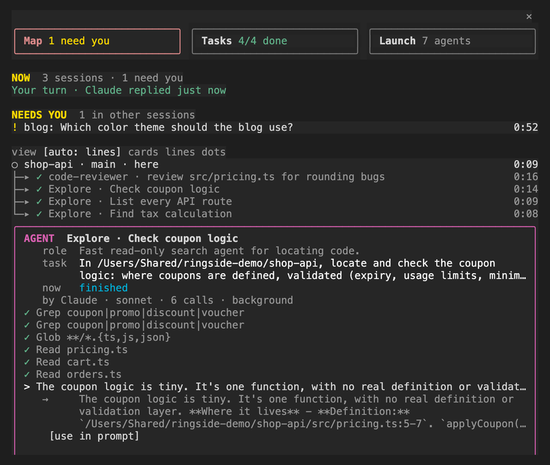
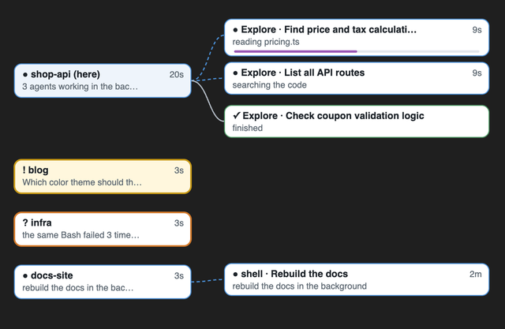

<h1 align="center">Agent Map</h1>

<p align="center">
  Every Claude Code session on your computer, and every subagent, shell and loop each one started, in one pane.
</p>

<p align="center">
  
  
  
</p>

<p align="center">
  
</p>

When you run several Claude sessions, or one session that fans out into subagents, it gets hard to answer simple questions. What is running right now? Which agent is doing what, and for how long? Is anything waiting on me? Is something stuck? Agent Map answers those in one pane, in plain words.

- **What is running.** Each session is a box. What it started hangs under it with `├─▸` / `└─▸`: subagents, background shells, loops and workflow agents.
- **What each agent is for and what it is doing.** Its type and task, and its current step in plain words ("reading pricing.ts", "running tests", "listing files"), with a clock.
- **Press to look inside.** Press any box to Peek; it opens as a card right under what you pressed. For an agent that is its role, task, steps, cost and result. For a session it is what it last said, its folder, its terminal, plus Jump there and what the jump did.
- **What needs you.** NEEDS YOU sits on top across every session: questions, plan approvals and permission prompts, plus anything that may be stuck.
- **Tasks and a launcher.** Map, Tasks and Launch are three cards at the top. The Tasks tab is Claude's whole task list in order, the finished ones ticked. The Launch tab lists every agent type as a card, grouped by where it comes from (the project's `.claude/agents`, yours, plugins, built-in), with its colour and model on the left 70% and **▶ run** on the right 30%; run opens a task box across the card. Skills are cards too.

## Install

In Claude Code (2.1.287 or later), type:

```
/plugin install agent-map --marketplace ChiFungHillmanChan/agent-map
```

Answer `y` to add the marketplace, then pick the user scope so it runs in every session. Each session started after that shows the map. Sessions that were already open show up as plain boxes until they restart.

<details>
<summary>From the terminal, or from a clone</summary>

```sh
claude plugin marketplace add ChiFungHillmanChan/agent-map
claude plugin install agent-map@agent-map
```

Or load a clone for one session (edits hot-reload):

```sh
git clone https://github.com/ChiFungHillmanChan/agent-map
claude --plugin-dir ./agent-map
```

</details>

## Use

The map opens on the right when a session starts. In the terminal that needs the fullscreen layout (`/tui fullscreen`) and enough width. In a narrower window it sits above the prompt and picks a denser view.

| Command | Does |
| --- | --- |
| `/agent-map` | open the map, or bring it in front of other panes |
| `/agent-map map` · `tasks` · `launch` | open on that tab |
| `/agent-map zoom auto\|cards\|lines\|dots` | how dense the map is (`auto` picks the densest view that fits) |
| `/agent-map close` | close the pane |
| `/agent-map clear` | clear this session's part of the map: its agents, jobs and task list |
| `/agent-map say <text>` | post a note to the repo board (below) |
| `/agent-map report` | ask Claude for a status report of the repo's sessions |

Keyboard: `ctrl+x tab` moves focus into the pane. Then `Tab` / `shift+Tab` walk the boxes and buttons, `Enter` presses, and `x` closes a Peek.

<p align="center">
  
</p>

### What counts as "needs you" and "may be stuck"

- **Needs you:** a question Claude asked, a plan waiting for approval, a permission prompt, a subagent waiting on you, or a question Claude ended its answer on. The same goes for other sessions on this computer. A wait older than 24 hours counts as old news, not a need.
- **May be stuck:**
  - the same call failed 3 times in a row;
  - Claude has been working for 10 minutes with no new step;
  - one step in the foreground has run for over 20 minutes.

  Background shells, waits on you and subagent calls never count as stuck.

While the pane is not on screen, one row above the prompt says when another session waits on you or something may be stuck, with an **Open map** button. Nothing else is ever drawn there.

### Peek

| You press | You see |
| --- | --- |
| a subagent | its role, task, what it is doing now, its steps, who started it, its model, cost and context, the steps it took, and its result with **use in prompt** |
| another session | what it last said, its folder and terminal, what it started, **Jump there**, and whether the jump worked |
| this session | the repo board, and **replay the last turn's edits** when [Replay Theater](https://github.com/anthropics/claude-code-playground/tree/main/claude-code/mods/replay-theater) is loaded |
| a loop or a background shell | its details and a **Stop** that takes two presses |

**Jump there** brings that session's terminal forward:

- Terminal or iTerm2 on macOS, found by the session's tty.
- A tmux pane, on any system with tmux.
- `claude attach` for a background session.

### The repo board

Sessions working in the same git repository share a small board. Post a note with `/agent-map say <text>` or from this session's Peek. Claude can read and post through the `hub` tool it gets. Notes from other sessions that this session's Claude has not read are added to your next prompt. With **wake** on, your note also starts a turn in the sessions you post to.

### Desktop app

On the desktop app the map is also drawn as one picture above the same list:

<p align="center">
  
</p>

## Works with other mods

Agent Map joins other mods rather than replacing them. When one of these is loaded, the map uses it:

| Mod | What the map takes from it |
| --- | --- |
| [savvy-progress](https://github.com/johnnyvizz/claude-kit/tree/main/plugins/savvy-progress) | the steps each subagent reports (`▰▰▱▱ 2/4`) and its estimated cost |
| [Flightdeck](https://github.com/scasella/claude-flightdeck) | each subagent's context size, and workflow agents the engine's own list misses |
| [Replay Theater](https://github.com/anthropics/claude-code-playground/tree/main/claude-code/mods/replay-theater) | a **replay** button in this session's Peek |

It reads their state only when it has the shape it expects. Otherwise it acts as if the mod is not there. It never changes another mod's state.

## What it can reach

| It | How |
| --- | --- |
| watches this session's tool calls, subagent spawns and turns | `tool.call`, `agent.spawn`, `turn.start`, `turn.complete` hooks. It never denies, delays or rewrites a call, and never holds or drops your prompt. |
| lists the other sessions on this computer | reads Claude Code's own registry (`~/.claude/sessions/*.json`) and runs `ps` to drop sessions that have ended |
| shares what this session started | writes one small file per session to `~/.claude/mods-data/agent-map/hub/<repo>/<session>.json`, and reads the others' files |
| knows the repo and branch | runs `git rev-parse` in the session folder |
| shows a subagent's steps | reads that subagent's transcript, for this session's own subagents only |
| fills the launcher | reads agent files in `~/.claude/agents` and `<repo>/.claude/agents`, and the session's command list |
| Jump there | runs `osascript` (macOS) or `tmux` when you press it, and only then |
| the repo board | adds unread notes from other sessions in the same repo to your next prompt, and gives Claude a `hub` tool (`read`, `post`) |

It makes no network requests and calls no model. `CLAUDE_CONFIG_DIR` is respected. `claude plugin validate .` prints everything it hooks and calls.

## Limits

- No API can stop a subagent today, so Stop is offered for loops and background shells only.
- For another session's subagent, Peek shows the summary that session published, not its full transcript.
- A session only shares what it started once it runs Agent Map itself. For one that does not, its card says so. A background session that ended, or has sat blocked, for over a day is left off the map.
- Jump needs Terminal, iTerm2 or tmux. In other terminals it says it could not find the window.
- Mods are an early-access Claude Code feature, and their API can change between releases.

## How it was built

Agent Map started as a personal "cockpit" pane and was redesigned around four questions: what is running, which agent does what and for how long, can I look inside it, and what needs me. It was built with Claude Code's own mod engine (`claude plugin validate`, `claude plugin test`), then tried live in tmux with real sessions, subagents, waits and background shells. The GIF above is a real capture from that run.

- `hooks/map.ts`: the model, written as pure functions. It builds the map, says what needs you, applies the stuck rules and turns tool calls into plain words. It also draws the desktop picture.
- `hooks/fleet.ts`: the other sessions on this computer, and Jump.
- `hooks/hub.ts`: the board files and the repo board.
- `hooks/register.tsx`: the hooks and the pane.
- `tests/`: 55 tests. Several mount the pane on both the terminal and desktop surfaces.

## Develop

```sh
claude --plugin-dir .            # load it; edits hot-reload
claude plugin validate .
claude plugin test .
npx -p typescript@5 tsc -p .     # after the first load, which writes .claude-plugin/types/
```

## Credits

See [ACKNOWLEDGEMENTS.md](ACKNOWLEDGEMENTS.md).

## License

[MIT](LICENSE)
