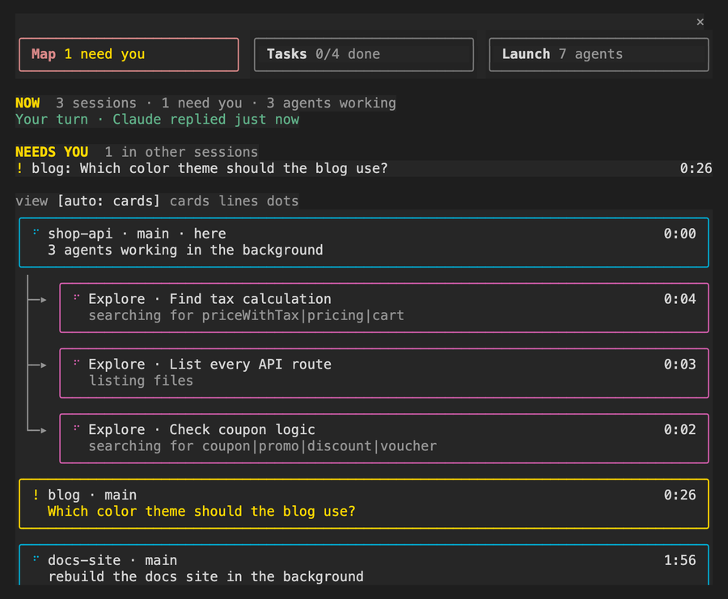
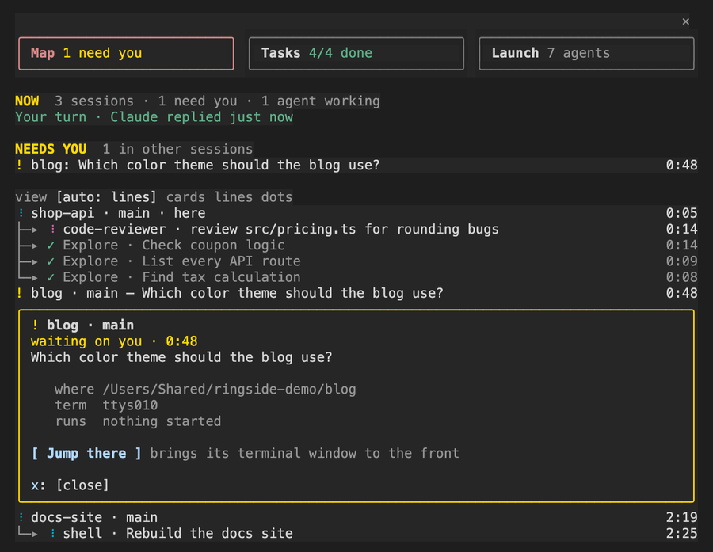
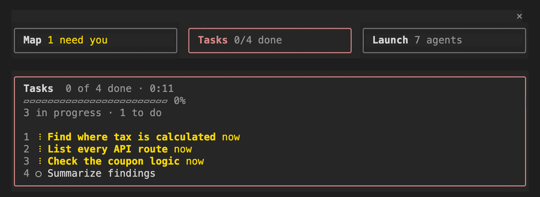
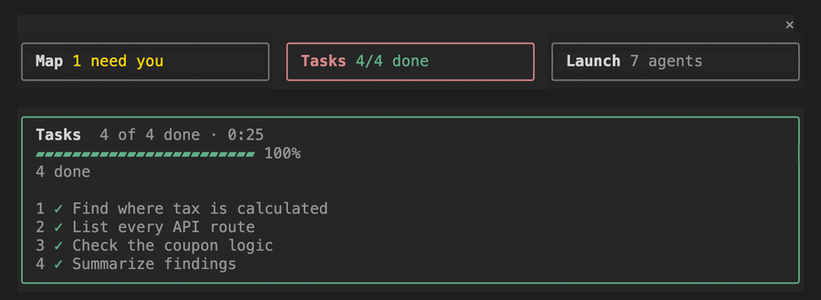
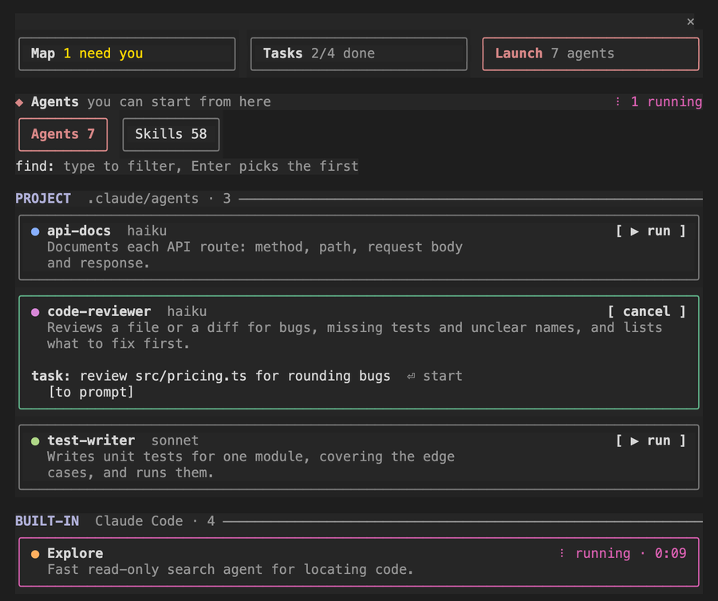
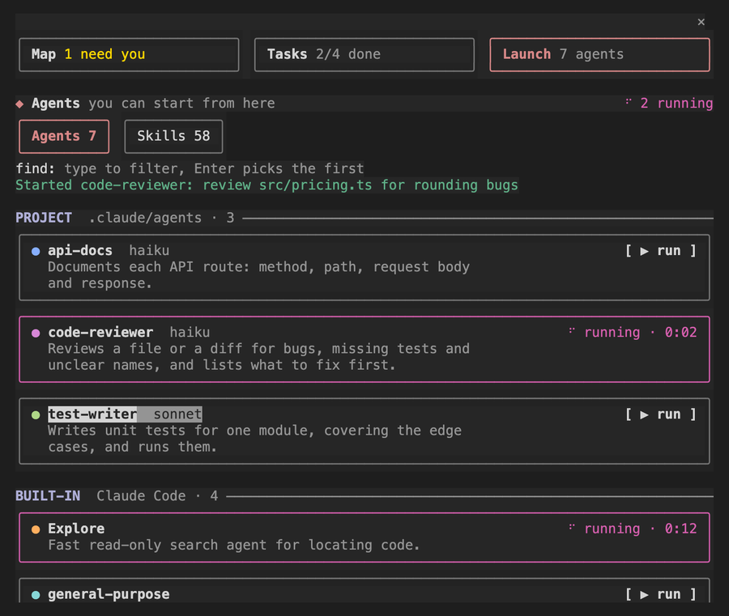

<h1 align="center">Ringside</h1>

<p align="center">
  <b>A ringside seat on every Claude Code session on your computer,<br>and every subagent, shell and loop each one started.</b>
</p>

<p align="center">
  <a href="https://github.com/ChiFungHillmanChan/ringside/releases"></a>
  <a href="https://github.com/ChiFungHillmanChan/ringside/actions/workflows/ci.yml"></a>
  
  
  <a href="LICENSE"></a>
  <a href="CONTRIBUTING.md"></a>
</p>

<p align="center">
  
</p>

<p align="center">
  <a href="#install">Install</a> ·
  <a href="#quick-start">Quick start</a> ·
  <a href="#how-to-use-it">How to use it</a> ·
  <a href="#commands">Commands</a> ·
  <a href="#faq-and-troubleshooting">FAQ</a> ·
  <a href="CONTRIBUTING.md">Contributing</a>
</p>

---

Ringside is a free, open-source mod for [Claude Code](https://claude.com/claude-code). It adds one pane, docked beside your conversation, that answers the questions you ask yourself when you run several Claude sessions, or one session that fans out into subagents:

- **What is running right now?** Every Claude Code session on this computer is a card. What each one started hangs under it: subagents, background shells, loops and workflow agents.
- **What is each agent doing, and for how long?** Each one shows its task, its current step in plain words ("reading pricing.ts", "running tests") and a clock.
- **Is anything waiting on me?** NEEDS YOU sits at the top across all your sessions: questions, plan approvals, permission prompts.
- **Is something stuck?** Ringside flags a session that keeps failing the same call, or has gone quiet for too long.
- **Can I look inside, or go there?** Press any card to open it in place. Press **Jump there** to bring that session's terminal window to the front.

It also gives you Claude's task list as a checklist and a launcher for every agent type in your project. Ringside runs on your machine only. It makes no network requests and calls no model.

> Ringside was called **Agent Map** up to version 0.8. If you installed it under that name, see [Coming from Agent Map](#coming-from-agent-map).

## Contents

- [Features](#features)
- [Requirements](#requirements)
- [Install](#install)
- [Quick start](#quick-start)
- [How to use it](#how-to-use-it)
  - [The pane at a glance](#the-pane-at-a-glance)
  - [Map](#map)
  - [Peek: look inside anything](#peek-look-inside-anything)
  - [Jump there](#jump-there)
  - [Tasks](#tasks)
  - [Launch](#launch)
  - [The repo board](#the-repo-board)
  - [When the pane is hidden](#when-the-pane-is-hidden)
  - [Desktop app](#desktop-app)
- [Commands](#commands)
- [Keyboard and mouse](#keyboard-and-mouse)
- [Works with other mods](#works-with-other-mods)
- [Privacy: what it reads and runs](#privacy-what-it-reads-and-runs)
- [FAQ and troubleshooting](#faq-and-troubleshooting)
- [Limits](#limits)
- [How it works](#how-it-works)
- [Contributing](#contributing)
- [Credits and license](#credits-and-license)

## Features

| | |
| --- | --- |
| **Every session, one map** | All Claude Code sessions on this computer, with the ones that need you first. Idle ones fold to one line each. Read from Claude Code's own session registry, so nothing else needs to be installed. |
| **What each session started** | Subagents, background shells, `/loop` schedules and workflow agents hang under their session with `├─▸` and `└─▸`, each with its task, current step and clock. |
| **NEEDS YOU** | Questions, plan approvals, permission prompts, and a subagent waiting on you, from every session, at the top of the pane. |
| **May be stuck** | The same call failing 3 times in a row, 10 minutes without a new step, or one foreground step running for more than 20 minutes. |
| **Peek** | Press any card to open it right where it is: an agent's role, task, steps and answer, or a session's last words, folder and terminal. |
| **Jump there** | Brings a session's terminal to the front (Terminal or iTerm2 on macOS, or tmux). For a background session it opens one with `claude attach`. |
| **Tasks** | Claude's task list as a checklist, in order: done ones ticked, the current one marked "now", with a progress bar. |
| **Launch** | Every agent type you can start, as a card grouped by where it comes from, with its colour and model. Press **▶ run**, type the task, press Enter. Skills are listed too. |
| **Repo board** | Sessions in the same git repository share a small notice board, and Claude can read and post to it. |
| **Plays well with others** | Reads [savvy-progress](https://github.com/johnnyvizz/claude-kit/tree/main/plugins/savvy-progress) and [Flightdeck](https://github.com/scasella/claude-flightdeck) when they are loaded, and offers [Replay Theater](https://github.com/anthropics/claude-code-playground/tree/main/claude-code/mods/replay-theater)'s replay. |

## Requirements

- **Claude Code 2.1.287 or newer.** Ringside is a mod, and mods need that version. Check yours with `claude --version`, and update with `claude update`.
- **A terminal, or the Claude Code desktop app.** In the terminal, the pane needs the fullscreen layout (`/tui fullscreen`). There it opens on the right by itself in a window at least 144 columns wide. In a narrower window, or on the main screen (tmux's default), it does not open by itself: `/ringside` opens it above the prompt.
- **For Jump there:** Terminal or iTerm2 on macOS. Under tmux, on any system, it shows the session's pane; bringing a terminal window forward, and **Open in Terminal**, work on macOS only.
- **Systems:** built and tested on macOS. Linux should work: listing sessions needs `ps`, and Jump needs tmux. Windows is untested. Reports are welcome.

## Install

### Option 1: inside Claude Code (recommended)

Type this in any Claude Code session:

```
/plugin install ringside --marketplace ChiFungHillmanChan/ringside
```

1. Answer `y` when it asks to add the `ChiFungHillmanChan/ringside` marketplace.
2. Pick the **user** scope, so Ringside runs in every session, in every project.
3. Start a new session, or restart the ones you have open. Ringside loads when a session starts.

### Option 2: from your terminal

```sh
claude plugin marketplace add ChiFungHillmanChan/ringside
claude plugin install ringside@ringside
```

### Option 3: from a clone (to try it, or to work on it)

```sh
git clone https://github.com/ChiFungHillmanChan/ringside.git
claude --plugin-dir ./ringside
```

This loads Ringside for that one session only. When you edit the files, the session reloads them as you save (hot reload).

To load a clone in every session instead, add its folder to `CLAUDE_CODE_PLUGIN_DIRS` in the `env` block of `~/.claude/settings.json`. Separate several folders with `:`.

```json
{
  "env": {
    "CLAUDE_CODE_PLUGIN_DIRS": "/path/to/ringside"
  }
}
```

### Update

```sh
claude plugin marketplace update ringside
claude plugin update ringside@ringside
```

Restart your sessions afterwards. You can also manage it with `/plugin` inside Claude Code. For a clone, run `git pull`.

### Uninstall

```sh
claude plugin uninstall ringside@ringside
claude plugin marketplace remove ringside
```

Ringside keeps one small file per session under `~/.claude/mods-data/ringside/`. You can delete that folder after uninstalling.

### Coming from Agent Map

The project, the plugin and the command were renamed in 0.9.0. To move over:

```sh
claude plugin uninstall agent-map@agent-map
claude plugin marketplace remove agent-map
claude plugin marketplace add ChiFungHillmanChan/ringside
claude plugin install ringside@ringside
```

The command is now `/ringside` (it was `/agent-map`), and Claude's board tool is now `mcp__ringside__hub`. Old links to `ChiFungHillmanChan/agent-map` redirect to this repository.

## Quick start

These steps take about five minutes and show you every part of Ringside.

1. **Install it** as shown in [Install](#install), then open a new terminal window that is at least 144 columns wide.
2. **Start Claude Code** in a project: `claude`. If the pane does not appear on the right, type `/tui fullscreen`, then `/ringside`.
3. **Open a second session** in another terminal window or tab, in any folder. Within a few seconds it appears on the map as its own card.
4. **Give Claude work that fans out.** In the first session, type:

   ```
   Create 3 tasks, then run 3 Explore agents in parallel: find where errors are handled,
   list the main entry points, and find the tests. Mark tasks done as you go.
   ```

   Each agent appears as a card under your session, with what it is reading or searching right now.
5. **Press the Tasks card** at the top of the pane. You see the checklist fill in, with the tasks in progress marked **now**.
6. **Press the Launch card.** Every agent type you can start is listed. Press **▶ run** on one, type a task such as `review the last commit`, and press Enter. Its card shows **running**, and on the Map it hangs under your session with the others.
7. **Press any card on the Map.** It opens right where it is. For an agent you see its role, task, steps and answer. For a session you see what it last said, its folder and its terminal, plus **Jump there**.
8. **In the second session, ask something that needs an answer from you** ("Ask me which colour to use, light or dark"). The first session's pane lists it under **NEEDS YOU**.

## How to use it

### The pane at a glance

```
 ╭────────────────╮ ╭────────────────╮ ╭─────────────────╮
 │ Map 1 need you │ │ Tasks 2/4 done │ │ Launch 7 agents │  (1)
 ╰────────────────╯ ╰────────────────╯ ╰─────────────────╯
 NOW  3 sessions · 1 need you · 3 agents working            (2)
 Claude working 0:10 · Find where tax is calculated

 NEEDS YOU  1 in other sessions                             (3)
 ! blog: Which color theme should the blog use?   0:34

 view [auto: cards] cards lines dots                        (4)
 ╭──────────────────────────────────────────────────────╮
 │ shop-api · main · here                          0:10 │   (5)
 │   Find where tax is calculated                       │
 ╰──────────────────────────────────────────────────────╯
  ├─▸ Explore · Find tax calculation             0:03       (6)
  │     searching the code
  └─▸ ✓ Explore · List every API route           0:11
        → shop-api has 4 routes...                          (7)
```

1. **Three tabs**, each a card you press: Map, Tasks and Launch, each with a count.
2. **One line about everything**, then what this session is doing.
3. **NEEDS YOU:** whatever waits on you, from any session, with how long it has waited.
4. **How dense the map is.** `auto` picks the densest view that fits.
5. **A session:** its name, its branch, and `here` for the one you are in.
6. **What it started**, hanging under it, with its current step in plain words and a clock.
7. **Its answer**, once it is done.

Every card and every line on the map is a button. Press it with the mouse, or move to it with the keyboard (see [Keyboard and mouse](#keyboard-and-mouse)).

### Map

<p align="center"></p>

The map lists every Claude Code session on this computer:

- **This session** comes first, marked `here`.
- **Sessions that need you** come next, drawn in yellow with a `!`.
- **Sessions that are working** follow, with a spinner.
- **Idle sessions** fold into one line each under IDLE. Press one to open it.

Under each session hangs what it started: subagents (`Explore · Find tax calculation`), background shells (`shell · Rebuild the docs site`), loops and workflow agents. Each shows its current step in plain words and how long it has been running. When it finishes it gets a `✓` and the first line of its answer.

**How dense the map is.** `view auto` picks the densest view that still fits the pane. You can pick one yourself with the `view` row or with `/ringside zoom`:

| View | Shows |
| --- | --- |
| `cards` | a bordered card per session and per agent, with its current step |
| `lines` | one line per session and per agent |
| `dots` | one row per session, with a dot per thing it started |

**What counts as "needs you".** A question Claude asked, a plan waiting for approval, a permission prompt, a subagent waiting on you, or a question Claude ended its answer on. The same goes for every other session. A wait older than 24 hours counts as old news, not a need.

**What counts as "may be stuck".**

- the same call failed 3 times in a row;
- Claude has been working for 10 minutes with no new step;
- one step in the foreground has run for more than 20 minutes.

Background shells, waits on you and subagent calls never count as stuck.

### Peek: look inside anything

Press a card and it opens right under itself. Press `[close]` or `x` to fold it again.

| You press | You see |
| --- | --- |
| a subagent | its role, its task, what it is doing now, who started it, its model, the number of calls, the steps it took, and its answer with **[use in prompt]** |
| another session | what it last said, its folder, its terminal, what it started, **Jump there**, and what the last jump did |
| this session | the repo board, and **[replay the last turn's edits]** when Replay Theater is loaded |
| a loop or a background shell | its details, and a **Stop** that needs two presses |

<p align="center"><br><em>A session: what it is waiting on, where it runs, Jump there</em></p>

<p align="center"><br><em>An agent: role, task, steps and answer</em></p>

### Jump there

**Jump there** brings that session's window to the front, so you can answer it:

- **Terminal or iTerm2 on macOS:** Ringside finds the window and tab by the session's terminal device (`ttys011`). A Terminal window minimised to the Dock comes back.
- **tmux, on any system:** it selects the pane that runs the session in its tmux window. On macOS it also brings that terminal window forward; elsewhere the card says `Showed blog's pane in its tmux window`, and you switch to that terminal yourself.
- **A background session (macOS):** the button says **Open in Terminal** and opens a new Terminal window running `claude attach <id>`.

The card then says what happened, for example `Switched to blog's terminal (ttys011)`. If it could not, it says why, for example `its terminal window was not found (Terminal, iTerm2 and tmux were checked)`.

The first time you jump, macOS may ask whether your terminal may control Terminal or iTerm2. Allow it, or the jump cannot move the window.

### Tasks

<p align="center"><br><em>While Claude works</em></p>

<p align="center"><br><em>When the work is done</em></p>

The Tasks tab is this session's task list, the one Claude keeps with its task tools, in Claude's own order:

- `✓` a done task, kept on the list and dimmed;
- a spinner, yellow text and **now** for a task in progress;
- `○` a task still to do.

The header counts them (`2 of 4 done · 0:26`), with a bar and the time since the list began. The tab card at the top shows the same count (`Tasks 2/4 done`), so you can watch progress from the Map too.

### Launch

<p align="center"><br><em>Press ▶ run and type the task</em></p>

<p align="center"><br><em>Enter starts it in the background</em></p>

The Launch tab lists every agent type you can start, as cards in sections:

| Section | Where the agents come from |
| --- | --- |
| PROJECT | `.claude/agents/` in this repository |
| YOURS | `~/.claude/agents/` |
| PLUGINS | plugins you have installed |
| BUILT-IN | Claude Code's own (Explore, general-purpose, Plan and others) |

Each card shows the agent's colour, name, model and description on the left, and **▶ run** on the right.

1. Press **▶ run**. A task box opens across the card, empty, with the keys already in it. **[cancel]** takes run's place.
2. Type what the agent should do and press Enter. It starts in the background, and the card shows **running · 0:02**. Press that to see it on the map.
3. If you would rather write the request in the main prompt, press **[to prompt]**. The prompt is filled in, and Claude starts the agent when you send it.

Type in the **find** box to filter the list. Enter there picks the first match. Switch to **Skills** to see your skills the same way. A skill card offers **[run now]**, and its box takes the skill's arguments.

**Give your own agents a colour and a model.** Ringside reads both from the agent file:

```markdown
---
name: code-reviewer
description: Reviews a file or a diff for bugs, missing tests and unclear names.
tools: Read, Grep, Glob
model: haiku
color: purple
---

You review code. Read what you are pointed at, then list the problems you found...
```

The colours are `red`, `orange`, `yellow`, `green`, `cyan`, `blue`, `purple` and `pink`, or any `#rrggbb` colour. An agent with no colour gets a steady one picked from its name.

### The repo board

Sessions working in the same git repository share a small notice board:

- Post to it with `/ringside say <text>`, or from this session's Peek.
- Claude gets a `hub` tool (`mcp__ringside__hub`) to `read` the board and `post` to it.
- Notes from other sessions that this session's Claude has not read yet are added to your next prompt, so Claude knows what the others are doing.
- With **wake** on, your note also starts a turn in the sessions you post to.
- `/ringside report` asks Claude for a status report of every session in the repository.

### When the pane is hidden

While the pane is not on screen, Ringside stays out of your way. It draws one row above the prompt only when another session waits on you or something may be stuck, with an **Open map** button. Nothing else is ever drawn there, and it never holds or changes what you type.

### Desktop app

In the Claude Code desktop app, the map is also drawn as one picture above the same list:

<p align="center"></p>

## Commands

| Command | What it does |
| --- | --- |
| `/ringside` | Open the pane, or bring it in front of other panes. |
| `/ringside map` | Open on the Map tab. |
| `/ringside tasks` | Open on the Tasks tab. |
| `/ringside launch` | Open on the Launch tab. |
| `/ringside zoom auto` | Set how dense the map is: `auto`, `cards`, `lines` or `dots`. `auto` picks the densest view that fits. |
| `/ringside close` | Close the pane. `/ringside` opens it again. |
| `/ringside clear` | Clear this session's part of the map: its agents, jobs and task list. |
| `/ringside say <text>` | Post a note to the repo board. |
| `/ringside report` | Ask Claude for a status report of every session in this repository. |

## Keyboard and mouse

**Mouse:** press any card, tab, line or button. In tmux, turn the mouse on first with `set -g mouse on` in `~/.tmux.conf`.

**Keyboard:**

| Keys | What they do |
| --- | --- |
| `ctrl+x` then `tab` | Move the keys from the prompt into the pane. If another mod draws a row above the prompt, the first press goes there, so press again. |
| `tab` / `shift+tab` | Walk the cards and buttons. The one you are on is drawn inverted. |
| `enter` | Press it. |
| `x` | Close the open Peek. |
| `esc` | Go back to the prompt. |

## Works with other mods

Ringside joins other mods rather than replacing them. When one of these is loaded, it uses it:

| Mod | What Ringside takes from it |
| --- | --- |
| [savvy-progress](https://github.com/johnnyvizz/claude-kit/tree/main/plugins/savvy-progress) | the steps each subagent reports (`▰▰▱▱ 2/4`) and its estimated cost |
| [Flightdeck](https://github.com/scasella/claude-flightdeck) | each subagent's context size, and workflow agents that Claude Code's own list misses |
| [Replay Theater](https://github.com/anthropics/claude-code-playground/tree/main/claude-code/mods/replay-theater) | a **replay** button in this session's Peek |

It reads another mod's state only when that state has the shape it expects, and otherwise acts as if the mod is not there. It never changes another mod's state.

## Privacy: what it reads and runs

Ringside works only on your computer. **It makes no network requests and calls no model.**

| It | How |
| --- | --- |
| watches this session's tool calls, subagents and turns | through the `tool.call`, `agent.spawn`, `agent.offer`, `prompt.submit`, `turn.start`, `turn.complete` and `classic.Stop` hooks. It never denies, delays or rewrites a call, and never holds, drops or changes your prompt. |
| lists the other sessions on this computer | reads Claude Code's own session registry (`~/.claude/sessions/*.json`), and runs `ps` to leave out sessions that have ended |
| shares what this session started | writes one small file per session to `~/.claude/mods-data/ringside/hub/<repo>/<session>.json`, and reads the other sessions' files |
| knows the repository and branch | runs `git rev-parse` in the session's folder |
| shows a subagent's steps | reads that subagent's transcript, for this session's own subagents only |
| fills the launcher | reads agent files in `~/.claude/agents` and `<repo>/.claude/agents`, and the session's command list |
| Jump there | runs `osascript` (macOS) or `tmux` when you press it, and only then |
| the repo board | adds unread notes from other sessions in the same repository to your next prompt, framed as what those sessions said, not as your instructions, and gives Claude the `hub` tool |

`CLAUDE_CONFIG_DIR` is respected. Run `claude plugin validate .` in a clone to see every hook and call Ringside makes. To report a security problem, see [SECURITY.md](SECURITY.md).

## FAQ and troubleshooting

<details>
<summary><b>The pane does not appear.</b></summary>

- Make sure your Claude Code is 2.1.287 or newer (`claude --version`).
- In the terminal, turn on the fullscreen layout with `/tui fullscreen`.
- The pane opens by itself only in a window at least 144 columns wide. In a narrower window, type `/ringside` and it opens above the prompt.
- Ringside loads when a session starts. Sessions that were open when you installed it need a restart.
- Check that it is installed and enabled: `claude plugin list`.

</details>

<details>
<summary><b>Other sessions show as plain cards with "not shared".</b></summary>

A session shares what it started only if it runs Ringside itself. Sessions that were open before you installed Ringside show up from Claude Code's registry, but without their agents. Restart them and they share everything.

</details>

<details>
<summary><b>Jump there did not bring the window forward.</b></summary>

- Jump works with Terminal and iTerm2 on macOS, and with tmux. In other terminals the card says it could not find the window.
- On macOS, allow your terminal to control Terminal or iTerm2 under System Settings › Privacy & Security › Automation.
- If the session's tmux server has no client attached, there is no window to switch to.
- The card under the session says exactly what the jump did, or why it could not.

</details>

<details>
<summary><b>Clicks do nothing in tmux.</b></summary>

Turn the mouse on in tmux with `set -g mouse on` in `~/.tmux.conf`, then run `tmux source-file ~/.tmux.conf`. Or use the keyboard: `ctrl+x` then `tab` to move into the pane.

</details>

<details>
<summary><b>Launch says "Not started: ... auto mode classifier gave no verdict".</b></summary>

In auto permission mode, Claude Code asks its safety check before an agent starts. If the check gives no answer, the agent does not start. Press **▶ run** again, or start the agent with **[to prompt]** instead.

</details>

<details>
<summary><b>Typing after ▶ run went into the main prompt.</b></summary>

Ringside moves the keys into the task box only while the main prompt is empty, so it never takes over a half-typed message. Click the task box to type there.

</details>

<details>
<summary><b>An old background session I no longer care about is still listed.</b></summary>

Background sessions that are done, or have been blocked for more than a day, are left off the map. To end one sooner, open `claude agents`, the background agent view, and stop it there.

</details>

<details>
<summary><b>Does it slow Claude down, or cost tokens?</b></summary>

No model calls and no network. It redraws once a second while something is running, here or in another session, or this session has a task list, and every 30 seconds otherwise. The repo board adds a few lines to your prompt only when another session in the same repository has posted a note you have not seen.

</details>

## Limits

- No API can stop a subagent today, so **Stop** is offered for loops and background shells only.
- For another session's subagent, Peek shows the summary that session published, not its full transcript.
- A session shares what it started only once it runs Ringside itself.
- Jump needs Terminal or iTerm2 on macOS, or tmux.
- Where an organization manages Claude Code, a plugin you install gets no `Stop` hook. There a loop or background shell leaves the map on its notification alone.
- Mods are an early-access Claude Code feature, and their API can change between releases.

## How it works

```
hooks/
  register.tsx   the hooks and the pane: tabs, map, Peek, Tasks, Launch, the band
  map.ts         the model, as pure functions: builds the map, decides what needs you,
                 applies the stuck rules, turns tool calls into plain words, draws the desktop picture
  fleet.ts       the other sessions on this computer, and Jump there
  hub.ts         the per-session board files and the repo board
  agents.ts      the launcher catalogue: agent files, sections, colours
  loops.ts       /loop schedules and self-paced loops
  mask.ts        masks personal details on screen while CLAUDE_MODS_RECORDING=1 is set
types/
  index.d.ts     the shape of everything Ringside keeps in Claude Code's state
tests/           72 tests; several mount the pane on both the terminal and desktop surfaces
```

Each session that runs Ringside publishes a small file about itself (its state, what it is doing, what it started). Every session reads the others' files and Claude Code's own session registry, and draws the map from both.

## Contributing

Bug reports, ideas and pull requests are welcome. Start with [CONTRIBUTING.md](CONTRIBUTING.md), which covers how to load your clone, run the checks and send a change.

- Found a bug? [Open an issue](https://github.com/ChiFungHillmanChan/ringside/issues/new/choose).
- Found a security problem? Follow [SECURITY.md](SECURITY.md), and please do not open a public issue.
- Everyone taking part agrees to the [Code of Conduct](CODE_OF_CONDUCT.md).

Thanks to everyone who has contributed:

<a href="https://github.com/ChiFungHillmanChan/ringside/graphs/contributors"></a>

## Credits and license

Ringside builds on ideas and state from other Claude Code mods. See [ACKNOWLEDGEMENTS.md](ACKNOWLEDGEMENTS.md). What changed in each version is in [CHANGELOG.md](CHANGELOG.md).

Released under the [MIT License](LICENSE). Ringside is a community project and is not affiliated with or endorsed by Anthropic.
